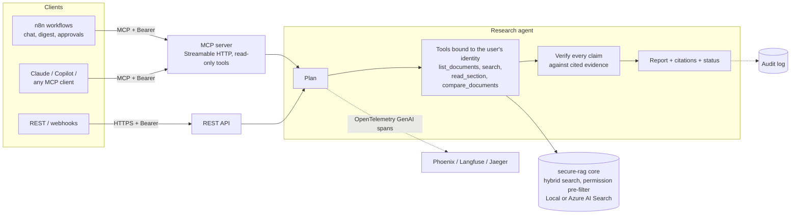

# Secure Research Agent

An agentic research assistant for company documents. It breaks hard questions into steps, searches and
reads documents, compares document versions, and returns a report in which **every claim is checked
against the evidence it cites**. It only ever sees documents the user can already open.

It plugs into the tools teams already use: it is an **MCP server** (for Claude, Copilot, n8n or any MCP
client), a REST API, and a set of **n8n workflows** (chat assistant, weekly digest, human approval).

Built on [secure-rag-m365](https://github.com/musman-uet/secure-rag-m365) (permission-trimmed hybrid search
over Word, PDF and Excel, with an Azure AI Search backend).

```text
$ python -m research_agent ask --user bilal "What changed between the 2023 and 2025 travel policy?"

[AI-generated research | status: answered | mode: offline]

- Scope changed. Travel Policy 2025 now says: This policy applies to all business travel ... within Pakistan and abroad. [E1][E2]
- Approval changed. Travel Policy 2025 now says: International travel also requires approval from the department head. [E3][E4]
- Daily meal allowance: PKR 3,000 in Travel Policy 2023, PKR 4,500 in Travel Policy 2025. [E5][E6]
- Hotel accommodation: PKR 15,000 in Travel Policy 2023, PKR 22,000 in Travel Policy 2025. [E7][E8]
- New in Travel Policy 2025, Mileage: Employees using a personal car for business travel are reimbursed PKR 65 per km. [E9]

Evidence:
  [E5] Travel Policy 2023 > Daily meal allowance, p.2 (updated 2023-02-01)
  [E6] Travel Policy 2025 > Daily meal allowance, p.2 (updated 2025-03-15)
  ...
Steps:
  list_documents() -> 6 documents
  compare_documents(doc_a='travel-2023', doc_b='travel-2025') -> 5 changes
```

The same question from a contractor (`--user zain`) returns *"I could not find an answer in the documents you
have access to."* The answer does not reveal that the policies exist.

## Why an agent and not plain RAG

A single search answers single questions. It fails on questions that need several steps:

- **Version comparison:** "What changed between the 2023 and 2025 policy?" needs both documents, read section by
  section and compared.
- **Multi-part questions:** "Who approves international travel and what is the mileage rate?" needs two searches.
- **Weak first results:** when search misses, the agent looks at the catalog and reads the most relevant section
  directly.

On the evaluation set the agent finds **0.88** of the expected facts. Single-shot RAG over the same index finds
**0.47** (details below).

## Architecture



**Two research strategies, same tools and guarantees:**

| Mode | How it plans | When to use |
|---|---|---|
| `offline` (default) | Deterministic rules: detects comparisons, splits multi-part questions, falls back from search to reading sections | CI, demos without keys, fallback when the LLM is down |
| `llm` (`RESEARCH_LLM=on`) | The model picks tools in a ReAct loop (OpenAI-compatible tool calling: Azure OpenAI, OpenAI, Groq, vLLM) | Paraphrased or open-ended questions |

## Safety guarantees

| Guarantee | How |
|---|---|
| Users only see what they can already open | Every tool is bound to the identity from the bearer token. No tool takes a user or group argument, and the model cannot pass one: extra arguments are rejected. Search uses the permission pre-filter from secure-rag. |
| Restricted content is not revealed | Unknown and forbidden documents get the same answer. Restricted chunks are never registered as evidence. |
| Every claim is backed by evidence | Claims cite evidence ids (`E3`). A verifier checks that every number in a claim appears in the cited text, and that most of its words do. Unsupported claims are removed and reported. |
| Contradictions are flagged | Conflicting figures across documents produce `conflicting_evidence` with both versions and their dates. |
| Bounded cost | Hard limits on tool calls and LLM iterations. |
| Prompt-injection resistant by design | Document text is treated as data. The agent's tools are read-only, and permissions are enforced in code, not by the model. |
| Auditable and observable | A JSONL audit record per run (user, tools used, documents read and cited, status; no document text). OpenTelemetry spans follow the GenAI semantic conventions (`invoke_agent`, `execute_tool`, `chat`), without question text. |
| AI output is labelled | Every report has `ai_generated: true`. |

## Evaluation

`python -m research_agent eval`, on 24 questions and 5 users. Offline mode, no LLM. Full table:
[`eval/results.md`](eval/results.md).

| Metric | Research agent | Single-shot RAG (v1) |
|---|---|---|
| Fact recall (answerable questions) | **0.88** | 0.47 |
| Status accuracy | **92%** | 83% |
| Citation precision | 1.00 | n/a |
| Tool calls per question (median) | 3 | 1 search |

**Permission leaks: 0** across 402 documents read by the agent (every user × every question, counting documents
read, not only those cited). CI fails if this is ever above 0.

**Where it falls short:** the 2 misses are paraphrased questions ("vacation days", "production is completely
down"). The offline strategy matches words, not meaning, so it says "not found" rather than guess. The LLM
strategy is meant for these, but its accuracy is not measured here yet, because that needs an API key.
The question set is small and was written alongside the code, so treat these numbers as a working evaluation
harness, not a benchmark.

## Quick start

```bash
python -m venv .venv && source .venv/bin/activate
pip install -r requirements.txt

python -m research_agent ask --user omar "Who approves international travel and what is the mileage rate?"
python -m research_agent eval
python -m pytest -q                                   # 60 tests

python -m research_agent serve-api --port 8000        # REST: POST /research
python -m research_agent serve-mcp --port 8001        # MCP: http://localhost:8001/mcp
```

Sample users: `ayesha` (HR), `bilal` (Finance), `sara` (Engineering), `omar` (Leadership), `zain` (Contractor).
Demo bearer tokens for each are in `data/tokens.json`.

```bash
curl -X POST localhost:8000/research -H "Authorization: Bearer <token>" \
     -H "Content-Type: application/json" -d '{"question": "When must expense claims be submitted and are receipts needed?"}'
```

### Use it from n8n

See [docs/n8n.md](docs/n8n.md). Five ready-to-import workflows: a webhook Q&A, a weekly policy digest, a chat
assistant where n8n's AI Agent uses this server as an MCP tool, a Slack approval step before anything leaves the
company, and a direct MCP call.

### Use the LLM strategy

Set `RESEARCH_LLM=on` and either `OPENAI_API_KEY` (plus `OPENAI_BASE_URL` for Groq or a local server) or the
`AZURE_OPENAI_*` variables. See `.env.example`.

### Use Azure AI Search

Set `RAG_BACKEND=azure` and the `AZURE_SEARCH_*` and `AZURE_OPENAI_*` variables. Index the documents with the
secure-rag core (`securerag.factory.ingest`). The Azure backend is unit-tested offline against the real
`azure-search-documents` SDK.

### Send traces to Arize Phoenix

```bash
pip install arize-phoenix && phoenix serve        # UI at http://localhost:6006
OTEL_EXPORTER_OTLP_ENDPOINT=http://localhost:6006 python -m research_agent serve-mcp
```

## What was tested, and where

| Part | Verified by |
|---|---|
| Tools, planner, verifier, budgets, audit | Unit tests |
| LLM tool-calling loop | Unit tests with a scripted fake model: tool use, removal of a fabricated claim, an injected `user` argument refused, an unknown tool, the budget limit, malformed output |
| MCP server | In-process MCP client, and **real HTTP**: 401 without or with a bad token, different documents per token |
| REST API | FastAPI test client |
| OpenTelemetry | In-memory exporter: span names, GenAI attributes, parent/child links, no question text |
| n8n workflows | Imported into **n8n 2.48.4**. Workflows 01, 02 and 05 executed end to end. Workflow 03 (AI Agent + MCP tool) ran with a scripted fake model. Workflow 04 imported only (needs Slack). See [docs/n8n.md](docs/n8n.md). |
| Live LLM and live Azure | **Not run here** (no keys). The code paths are covered by fakes and SDK-level tests. |

## Production notes

- **Identity:** replace `DemoTokenVerifier` with Microsoft Entra ID token validation (issuer, audience, signature,
  expiry), and read the user's object ID and `groups` claim. The MCP SDK's `TokenVerifier` interface is already
  used, so nothing else changes.
- **Permissions:** sync document ACLs from SharePoint (Microsoft Graph), or use Azure AI Search's SharePoint
  ACL ingestion.
- **Agent-to-agent:** the research tool is a natural A2A skill. Exposing an A2A endpoint is a next step.

## Project structure

```text
research_agent/
  tools.py        identity-bound tools + evidence registry
  offline.py      deterministic planner and executor
  llm.py          ReAct tool-calling loop for OpenAI-compatible models
  report.py       claims, citations, verifier
  agent.py        run loop, status, audit, wiring
  mcp_server.py   MCP server (Streamable HTTP, bearer auth, read-only tools)
  api.py          REST API
  identity.py     bearer token -> user (demo verifier)
  tracing.py      OpenTelemetry GenAI spans
securerag/        retrieval core from secure-rag-m365 (parsers, chunking, hybrid search, Azure backend)
n8n/              five importable n8n workflows
eval/             golden set + agent vs single-shot evaluation
tests/            60 tests
data/             sample documents of a fictional company, users, demo tokens
```

## License

MIT
